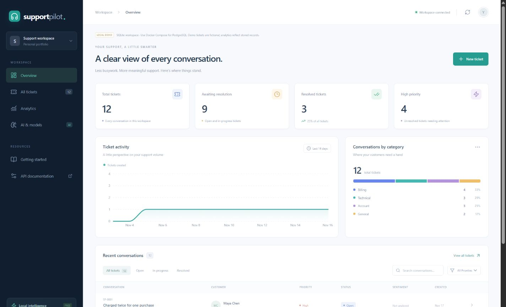
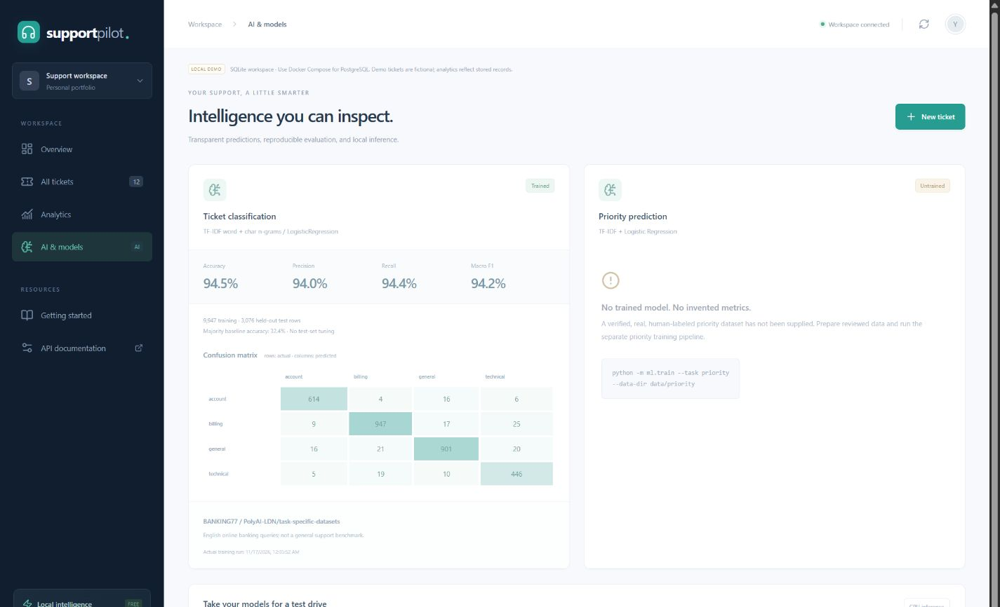

# AI Customer Support Automation System

**SupportPilot** — a local AI workspace for customer support teams.

A full-stack portfolio application for customer support triage: ticket management,
supervised classification, trainable priority prediction, pretrained sentiment analysis,
local LLM reply suggestions, and transparent model evaluation.

**React · FastAPI · PostgreSQL · Scikit-learn · PyTorch / Hugging Face · Ollama · Docker**

No paid API keys. All inference can run locally after first-time dependency/model downloads.
AI suggestions require human review; this application does not send customer messages.



*Actual browser capture of the local demonstration. Seed tickets are fictional; dashboard
counts come from persisted records. The local capture uses the explicitly labeled SQLite
demo mode. PostgreSQL is the main Docker configuration.*

## What works

- Create, view, edit, search, filter, paginate, and resolve support tickets.
- Inspect a persistent activity trail for creation, updates, analysis, and reply drafts.
- Classify ticket text with a real trained TF-IDF + logistic regression model.
- Train and serve an independent low/medium/high priority model when reviewed labels exist.
- Run local three-way sentiment inference using a pretrained PyTorch RoBERTa model.
- Generate professional suggested replies through Ollama, with actionable unavailable errors.
- Review suggestions before explicitly applying routing changes; no silent overwrites.
- Inspect ticket volume, categories, priorities, resolution rate, and sentiment trends.
- Inspect actual held-out evaluation, per-class scores, and confusion matrices.
- Run database migrations, automated tests, native Windows development, or Docker Compose.

## Honest model status

| Component | Implementation / evidence |
|---|---|
| Category classifier | Trained and evaluated on a documented four-category mapping of BANKING77 |
| Priority classifier | Pipeline, training CLI, and serving implemented; **untrained until reviewed real labels are supplied** |
| Sentiment | Pretrained three-class model integration; downloaded separately; no support-domain accuracy claim |
| Reply generation | Ollama integration; requires a locally installed model; drafts are never sent automatically |
| Demo tickets | Explicitly fictional UI examples, not ML training or evaluation records |

No fake metrics, random predictions, or keyword-generated priority ground truth are used.
Missing models return structured statuses such as `untrained` or `not_downloaded`.

## Architecture

```mermaid
flowchart LR
    UI[React dashboard] --> API[FastAPI REST API]
    API --> DB[(PostgreSQL: tickets and audit events)]
    API --> CLF[Scikit-learn category / priority pipelines]
    API --> SENT[PyTorch RoBERTa sentiment]
    API --> LLM[Local Ollama reply generation]
    DATA[Versioned public data / approved reviewed labels] --> PREP[Pandas cleaning and split checks]
    PREP --> TRAIN[Train-only TF-IDF fit + logistic regression]
    TRAIN --> EVAL[Held-out evaluation and provenance]
    TRAIN --> CLF
```



The API runs inference in synchronous worker threads. Long model downloads and training
are explicit CLI commands, never hidden inside a ticket request. Ticket versioning detects
stale concurrent writes. Editing subject/description invalidates saved AI analysis and drafts.

## Requirements

- Windows 10/11, VS Code, PowerShell; or Linux/macOS equivalents.
- Python **3.12**, Node.js **22**, and npm for native development.
- [Docker Desktop](https://www.docker.com/products/docker-desktop/) with Compose for the PostgreSQL stack,
  or an independently installed PostgreSQL **16** instance.
- [Ollama](https://ollama.com/download) for reply suggestions.
- A typical CPU laptop works. **8 GB RAM minimum, 16 GB recommended**, with several GB of disk
  for dependencies and model weights. Sentiment is roughly a 125M-parameter encoder;
  Ollama memory/latency depends on the selected model. No GPU is required.

## Option A: Docker + PostgreSQL

From the project root in PowerShell:

```powershell
Copy-Item .env.example .env
docker compose up --build -d
docker compose exec backend python -m app.seed
```

Open **http://127.0.0.1:5174**. FastAPI docs: **http://127.0.0.1:8001/docs**.
Compose waits for PostgreSQL and runs Alembic migrations before starting the backend.
Seeding is opt-in and skips a nonempty workspace. The API still works without AI artifacts.

Train the category classifier and download sentiment:

```powershell
docker compose exec backend python -m ml.prepare_banking --revision 57ec275d8078af65b7731c2a98be812d844a6d6b
docker compose exec backend python -m ml.train --task category --data-dir data/category
docker compose exec backend python -m ml.download_sentiment
```

On the **host**, start Ollama and install its configured model:

```powershell
ollama pull llama3.2:3b
```

Compose connects to host Ollama through `host.docker.internal:11434`. If Docker cannot
reach a loopback-only Ollama service, run the native backend instead or configure an
appropriate host binding restricted by your firewall. Do not expose an unauthenticated
Ollama or application API to the public internet.

```powershell
docker compose logs -f backend
docker compose down
```

The PostgreSQL named volume persists after `down`. `docker compose down -v` permanently
deletes the Compose database volume; use it only for a deliberate reset after backup.
Host-mounted `backend/models`, `data`, and `reports` persist separately.

## Option B: Native Windows / VS Code

Open the project folder in VS Code. In a PowerShell terminal:

```powershell
Set-Location backend
python -m venv .venv
.\.venv\Scripts\python.exe -m pip install -r requirements.lock.txt
Copy-Item .env.example .env
```

Use `.\.venv\Scripts\python.exe` directly if PowerShell blocks activation. There is no
need to change system execution policy. On Linux/macOS use `.venv/bin/python` instead.

Start PostgreSQL, either with `docker compose up -d db` from the project root or a local
installation. With a native installation, create a dedicated database/user (example local
credentials; choose your own for any non-demo setup):

```sql
CREATE USER supportpilot WITH PASSWORD 'supportpilot_local_only';
CREATE DATABASE supportpilot OWNER supportpilot;
```

Verify `DATABASE_URL` in `backend/.env`, then run from `backend/`:

```powershell
.\.venv\Scripts\python.exe -m alembic upgrade head
.\.venv\Scripts\python.exe -m app.seed
.\.venv\Scripts\python.exe -m uvicorn app.main:app --host 127.0.0.1 --port 8001
```

In a second terminal, from `frontend/`:

```powershell
npm ci
npm run dev
```

The UI runs on port **5174**, with `/api` proxied to FastAPI on **8001**. Those ports keep
this project separate from other local apps such as Folio.

### Lightweight SQLite demo when PostgreSQL is unavailable

SQLite is an explicit development fallback, not a claim of PostgreSQL runtime testing:

```powershell
# backend/
New-Item -ItemType Directory -Force data | Out-Null
$env:DATABASE_URL = 'sqlite:///./data/demo.db'
.\.venv\Scripts\python.exe -m alembic upgrade head
.\.venv\Scripts\python.exe -m app.seed
.\.venv\Scripts\python.exe -m uvicorn app.main:app --host 127.0.0.1 --port 8001
```

The UI displays a SQLite demo label. Remove the environment override to return to the
PostgreSQL URL in `.env`: `Remove-Item Env:DATABASE_URL`.

## Training and local models

Run these commands from `backend/` using your environment's Python executable. The short
`python` form below assumes that environment is activated.

### Category model: reproducible real-data baseline

```powershell
python -m ml.prepare_banking --revision 57ec275d8078af65b7731c2a98be812d844a6d6b
python -m ml.train --task category --data-dir data/category
```

The official source train/test partitions are preserved, with exact normalized overlaps
removed from training. Pandas handles cleaning; NumPy supports numerical operations;
Scikit-learn pipelines fit word/character TF-IDF only on training data and train a
class-balanced logistic regression model. No feature selection or parameter tuning uses
the test split. The explicit intent mapping is in `ml/taxonomy.py`.

The verified run recorded in [backend/reports/category.json](backend/reports/category.json):

| Metric | Held-out result |
|---|---:|
| Accuracy | 94.54% |
| Macro precision | 94.02% |
| Macro recall | 94.45% |
| Macro F1 | 94.23% |
| Majority-class baseline accuracy | 32.44% |
| Training / test rows after cleaning | 9,947 / 3,076 |

These results apply to the **project-defined four-class mapping of English banking intents**,
not universal customer-support performance. Exact deduplication cannot exclude all near
duplicates. Confidence scores are not calibrated. The report includes source revision,
checksums, class counts, versions, per-class metrics, and the complete confusion matrix.
Models are ignored by Git; train them after cloning. The API reloads a classifier when its
artifact changes. Only load trusted locally generated joblib artifacts.

### Priority model: real reviewed data required

No suitable verified real priority dataset is bundled, so there are no priority evaluation
results to advertise. The independent training/serving implementation is complete.
Follow [docs/DATASETS.md](docs/DATASETS.md) for annotation policy and provenance requirements.

```powershell
python -m ml.prepare_priority --input reviewed.csv --source "Approved real dataset and dates" --license "Documented permission"
python -m ml.train --task priority --data-dir data/priority
```

Input requires `text`, human-reviewed `priority` (`low`, `medium`, `high`), and a stable
`group_id`. Group-hash separation keeps related customer/incident records out of both
training and test sets. Preparation refuses incomplete labels and tiny splits. Model input
contains only intake text, not resolution, SLA outcomes, agent responses, or customer IDs.

### PyTorch / Hugging Face sentiment

```powershell
python -m pip install 'torch>=2.6,<3' --index-url https://download.pytorch.org/whl/cpu
python -m pip install -r requirements-sentiment.txt
python -m ml.download_sentiment
```

The downloader loads the pinned upstream PyTorch weights with weights-only deserialization
(PyTorch >=2.6, no trusted remote code), then saves a local safetensors copy for
`cardiffnlp/twitter-roberta-base-sentiment-latest`. After download, inference loads local
files only, uses evaluation/inference mode, and truncates to 512 tokens. The output is
positive, neutral, or negative with a score. This pretrained English social-media model
has **not been evaluated on support-domain sentiment labels**. Restart the backend after
replacing the sentiment model directory. Set `SENTIMENT_ENABLED=false` to disable it.

### Ollama reply drafts

```powershell
ollama pull llama3.2:3b
```

Run Ollama's desktop app or `ollama serve`. Set `OLLAMA_MODEL` to another installed
instruction model if preferred; smaller models use less RAM but can produce weaker replies.
The prompt forbids invented account actions, refund promises, and requests for passwords.
Those instructions cannot guarantee safety or correctness: agents must review drafts.
Missing models, offline services, and timeouts return an actionable 503 and leave tickets intact.

## Configuration

Root `.env` configures Compose. `backend/.env` configures native execution. Environment
variables override files. Always run backend commands from `backend/` so relative paths are stable.

| Variable | Default / meaning |
|---|---|
| `DATABASE_URL` | PostgreSQL SQLAlchemy/psycopg URL; see backend example |
| `MODEL_DIR` | `models` — category/priority artifact directories |
| `SENTIMENT_DIR` | `models/sentiment` — local pretrained artifact |
| `SENTIMENT_ENABLED` | `true` — missing download still returns explicit status |
| `SENTIMENT_MODEL` | `cardiffnlp/twitter-roberta-base-sentiment-latest` |
| `SENTIMENT_REVISION` | `3216a57f2a0d9c45a2e6c20157c20c49fb4bf9c7` |
| `OLLAMA_URL` | `http://localhost:11434` (Compose uses host gateway) |
| `OLLAMA_MODEL` | `llama3.2:3b` |
| `INFERENCE_THRESHOLD` | `0.60` — review hint, not calibrated guarantee |
| `CORS_ORIGINS` | JSON list; localhost / 127.0.0.1 port 5174 |

## API documentation

Interactive OpenAPI: **http://127.0.0.1:8001/docs**.

| Method | Endpoint | Behavior |
|---|---|---|
| GET | `/api/health` | Database, model, and Ollama readiness |
| GET | `/api/tickets` | Search `q`, status/category/priority filters, page/page_size |
| POST | `/api/tickets` | Create a validated ticket |
| GET / PATCH | `/api/tickets/{id}` | Read or update; resolves/reopens timestamps |
| GET | `/api/tickets/{id}/events` | Activity audit trail |
| POST | `/api/tickets/{id}/analyze` | Save category/priority/sentiment suggestions |
| POST | `/api/tickets/{id}/reply` | Save a local LLM draft; body may contain `instructions` |
| POST | `/api/predict` | Analyze text without creating a ticket |
| GET | `/api/analytics` | Aggregated counts and 14-day UTC trends |
| GET | `/api/models` | Actual stored model reports or untrained states |

PowerShell example:

```powershell
$body = @{
  subject = 'Duplicate card payment'
  description = 'My card was charged twice for one purchase. Please help investigate.'
  customer_name = 'Demo Customer'
  customer_email = 'demo@example.test'
} | ConvertTo-Json
Invoke-RestMethod http://127.0.0.1:8001/api/tickets -Method Post -ContentType 'application/json' -Body $body
```

Categories: `billing`, `technical`, `account`, `general`. Priorities: `low`, `medium`, `high`.
Statuses: `open`, `in_progress`, `resolved`. Routing can be unassigned at creation. Updates
reject unknown fields and explicit null values. API errors include validation (422), missing
tickets (404), stale writes (409), and database/model-service availability failures (503).

## Verification and interview demo

```powershell
# backend/
python -m pytest -q
python -m alembic check
# frontend/
npm ci
npm run build
```

The automated suite covers lifecycle/filtering/analytics, validation, advisory analysis,
stale-result invalidation, missing model states, Ollama failure/success boundaries,
deduplication, group separation, leakage rejection, train-to-serve integration, and migration
upgrade/check/downgrade. Test-only constructed records are never reported as real benchmark data.

The original local verification used SQLite; Docker/PostgreSQL runtime verification requires
a working Docker/PostgreSQL installation. CI includes a PostgreSQL migration/API smoke job.
Do not treat a configured CI workflow as a passing CI run until it actually executes.
See [docs/VERIFICATION.md](docs/VERIFICATION.md) for the final local evidence and limitations.

The live local smoke check additionally verified real PyTorch sentiment inference and a
persisted Ollama draft with the lightweight installed `qwen2.5:0.5b` model. Its structured
record is [backend/reports/live-smoke.json](backend/reports/live-smoke.json). This confirms
service integration, not sentiment accuracy or reply quality. The default setup uses
`llama3.2:3b`; set `OLLAMA_MODEL=qwen2.5:0.5b` to reproduce the lighter demo configuration.



Use [docs/INTERVIEW_DEMO.md](docs/INTERVIEW_DEMO.md) for a structured walkthrough.
Development guidance is in [CONTRIBUTING.md](CONTRIBUTING.md), dataset sources and labeling
in [docs/DATASETS.md](docs/DATASETS.md), and the implementation plan in
[docs/IMPLEMENTATION_PLAN.md](docs/IMPLEMENTATION_PLAN.md).

## Project layout

```text
backend/
  app/                Typed API, SQLAlchemy models, database, seed data
    services/         Classifier loading, local sentiment, Ollama integration
  ml/                 Data preparation, taxonomy, training, sentiment download
  migrations/         Versioned Alembic schema changes
  reports/            Actual category evaluation and confusion counts
  tests/              Isolated API, ML, and migration checks
frontend/
  src/                React dashboard, inbox, ticket drawer, model lab
  nginx.conf          Container static serving and API proxy
docs/                 Data/model limitations, demo guide, screenshots
compose.yaml          PostgreSQL, migration, backend, frontend
```

## Practical limits and next steps

- **Local single-user demo:** no login, RBAC, tenant isolation, or public deployment hardening.
  Bind to loopback, use fictional records, and do not expose it to the internet as-is.
- **Data quality:** banking-domain intent labels are a baseline, not universal triage quality.
  Priority depends on an organization's policy, and text alone may not capture business impact.
- **Latency:** sentiment and LLM inference are CPU-bound and not streamed; initial loading can
  take time. Production needs a background job queue, retries, cancellation, and resource limits.
- **Privacy:** local storage contains customer text and email. Establish access, retention,
  deletion, backup, and redaction policies before using real data. No ticket deletion API is included.
- **Generation:** prompt injection and hallucinations remain possible. Do not let drafts
  trigger actions or claim that they have been verified automatically.
- **Operations:** provide a separate test PostgreSQL database, back up database/model/report
  versions together, and never run destructive test routines against customer records.
- **Model changes:** keep scikit-learn versions compatible with joblib artifacts or retrain.
  Pin and review new data/model revisions and licensing before redistribution.

## Attribution

- [BANKING77 / PolyAI](https://github.com/PolyAI-LDN/task-specific-datasets) and
  [Casanueva et al. (2020)](https://arxiv.org/abs/2003.04807), CC BY 4.0 dataset.
- [Cardiff NLP sentiment model](https://huggingface.co/cardiffnlp/twitter-roberta-base-sentiment-latest),
  CC BY 4.0 model; see its model card for TimeLMs/TweetNLP citations.
- Ollama model weights have their own licenses. Review the chosen model's terms separately
  from the open-source application dependencies.
